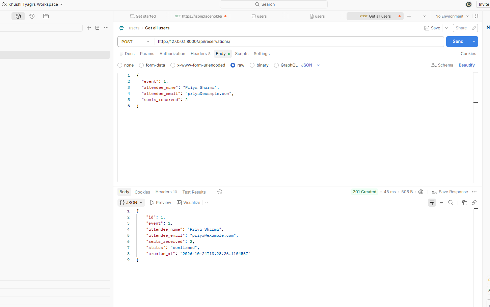
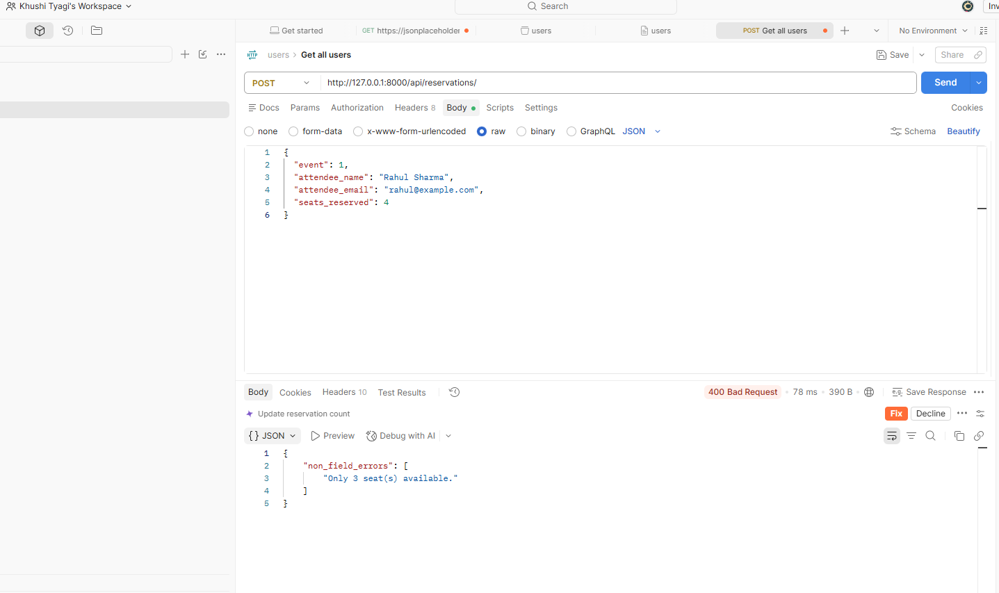
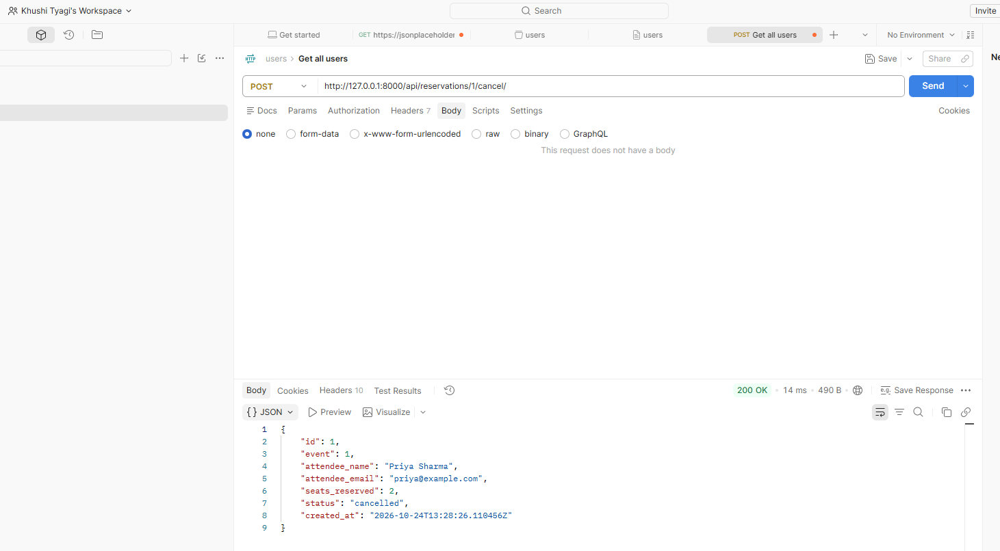

# EventHub API

EventHub is a REST API for an event ticketing platform built with Python, Django, and Django REST Framework (DRF).

The API allows users to create and browse events, reserve seats, cancel reservations, filter records, and check event availability. It includes input validation, seat availability management, request logging middleware, and automated API tests.

**GitHub Repository:** https://github.com/khushityaagi/EventHub

## Features

- Create, retrieve, update, and delete events.
- Filter events by status and venue.
- Create, retrieve, update, and list reservations.
- Validate reservation seat counts and event status.
- Reject reservations that exceed available seats.
- Cancel reservations and restore reserved seats.
- Filter reservations by event ID.
- Count confirmed reservations for each event.
- Log HTTP methods, request paths, response status codes, and request duration.
- Run automated API tests using Django REST Framework's `APITestCase`.

## Technology Stack

- Python
- Django
- Django REST Framework
- SQLite
- Django automated testing framework

## Project Setup

### 1. Clone the repository

```bash
git clone https://github.com/khushityaagi/EventHub.git
cd EventHub
```

### 2. Create and activate a virtual environment

Create the environment:

```powershell
python -m venv venv
```

Activate it on Windows PowerShell:

```powershell
.\venv\Scripts\Activate.ps1
```

### 3. Install dependencies

```powershell
python -m pip install -r requirements.txt
```

### 4. Configure the Django secret key

**Required:** The project expects the `DJANGO_SECRET_KEY` environment variable to be set before running Django management commands, including migrations and the development server.

Generate a development secret key:

```powershell
python -c "from django.core.management.utils import get_random_secret_key; print(get_random_secret_key())"
```

Copy the generated value and set it in your current PowerShell session:

```powershell
$env:DJANGO_SECRET_KEY = "paste-generated-key-here"
```

Replace the placeholder with the generated value. Keep the key private and never commit it to GitHub.

This environment variable applies to the current terminal session. If you open a new terminal, set it again.

### 5. Apply database migrations

```powershell
python manage.py migrate
```

### 6. Run the development server

```powershell
python manage.py runserver
```

The API server will be available at:

`http://127.0.0.1:8000/`

## API Endpoints

All API endpoints use the `/api/` prefix.

### Events

| Method | Endpoint | Description |
|---|---|---|
| GET | `/api/events/` | List events |
| POST | `/api/events/` | Create an event |
| GET | `/api/events/{id}/` | Retrieve an event |
| PUT/PATCH | `/api/events/{id}/` | Update an event |
| DELETE | `/api/events/{id}/` | Delete an event |

**Filtering examples**

- `/api/events/?status=upcoming` — filter events by status.
- `/api/events/?venue=Agra` — filter events by a case-insensitive partial venue match.

### Reservations

| Method | Endpoint | Description |
|---|---|---|
| GET | `/api/reservations/` | List reservations |
| POST | `/api/reservations/` | Create a reservation |
| GET | `/api/reservations/{id}/` | Retrieve a reservation |
| PUT/PATCH | `/api/reservations/{id}/` | Update a reservation |
| DELETE | `/api/reservations/{id}/` | Delete a reservation |
| POST | `/api/reservations/{id}/cancel/` | Cancel a reservation |

**Filtering example**

`/api/reservations/?event_id=1`

### Create an Event

**Request:** `POST /api/events/`

Example JSON body:

```json
{
  "title": "Django Conference",
  "venue": "Agra Convention Centre",
  "date": "2027-03-20",
  "total_seats": 100,
  "available_seats": 100,
  "status": "upcoming"
}
```

A successful request returns `201 Created` with the event details.

### Create a Reservation

**Request:** `POST /api/reservations/`

Example JSON body:

```json
{
  "event": 1,
  "attendee_name": "Asha Sharma",
  "attendee_email": "asha@example.com",
  "seats_reserved": 2
}
```

A successful reservation returns `201 Created`, creates a confirmed reservation, and deducts the requested number of seats from the event's available seats.

The `event` value must reference an existing event.

### Cancel a Reservation

**Request:** `POST /api/reservations/1/cancel/`

No request body is required.

A successful cancellation returns the updated reservation with status `cancelled` and restores the reserved seats. Repeated cancellation attempts return `400 Bad Request`.

## Validation and Error Handling

The API validates event data and reservation requests before accepting them.

Examples of rejected requests include:

- Reserving fewer than one seat.
- Reserving more seats than are available.
- Reserving seats for an event that is neither upcoming nor ongoing.
- Creating an event with zero total seats.
- Providing negative available seats.
- Setting available seats above total seats.
- Cancelling an already-cancelled reservation.

Invalid requests return `400 Bad Request` with error details.

## Postman Evidence

The following screenshots demonstrate the three required API scenarios. Open each image to view the request and response.

1. **Successful reservation — 201 Created**

   

   [View successful reservation screenshot](screenshot/01_successful_reservation.png)

2. **Overbooking rejected — 400 Bad Request**

   

   [View overbooking failure screenshot](screenshot/02_overbooking_failure.png)

3. **Successful cancellation — 200 OK**

   

   [View successful cancellation screenshot](screenshot/03_successful_cancellation.png)

## Automated Testing

Run the automated API tests with:

```powershell
python manage.py test events
```

The current test suite contains 14 tests covering event listing and filtering, event seat validation, reservation creation, overbooking rejection, cancellation, seat restoration, and reservation counts.

All 14 tests passed in the development environment during verification.

## Request Logging Middleware

`RequestLoggingMiddleware` records the HTTP method, request path, response status code, and request duration. Logs are written through the configured console logger.

## Design Decision

Seat availability updates are handled within the reservation creation logic, keeping booking validation and seat deduction close to reservation creation.

Database transactions and row-locking queries are also used during reservation creation and cancellation to improve consistency. However, row-level locking behavior depends on the database backend. SQLite does not provide the same row-level locking guarantees as PostgreSQL, so concurrent booking safety should be verified against the intended production database.

## Limitations

- SQLite is used for local development.
- Authentication and authorization are outside the current assignment scope.
- Production deployment requires appropriate secret management, security settings, and database configuration.
- Reservation update and deletion behavior should be reviewed carefully to ensure seat counts remain consistent if those operations are used.

## Author

**Khushi Tyagi**

GitHub: https://github.com/khushityaagi/EventHub